  

  

  
  
  

- 🛡️ **Security engineering** is my home turf — secure-by-design systems, threat modelling, and making the safe path the easy path.
- 👨‍💻 **Manager, Software Engineering** — Content Security Engineering (India) at **Barracuda Networks** (since Aug 2026).
- 🚀 Spent **~9 years as Head of Engineering** at **Head Digital Works (A23)**, growing teams and platforms from the ground up.
- 📍 Based in **Bengaluru, India** · ~**10 years** in software engineering.
- 🐾 Currently building **PawTrack** — a pet health app (because the dogs deserve good software too).
- ☕ Runs on coffee · 🐕 dog person · 🎮 gamer tag **Jarvis**.

    

  
  

<code>Numbers matter? ohhh yes.</code>

  
  
  

<code>jarvis@pranay:~$ exit 0</code> · secure by default, curious by nature

